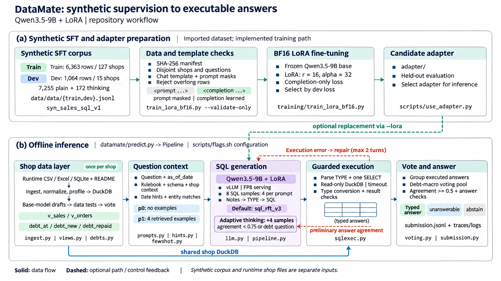

# DataMate · Zalo AI Challenge 2026

**Đội Zaic26-Foxel · Public Score: 0.78900 · SLM**

## Tóm tắt

DataMate trả lời câu hỏi tiếng Việt trên dữ liệu bán hàng có cấu trúc từ CSV, Excel và SQLite. Giải pháp kết hợp **Qwen3.5-9B được fine-tune bằng LoRA**, sinh SQL trên DuckDB và bỏ phiếu theo kết quả thực thi. Dữ liệu SFT tổng hợp, fine-tuning với dữ liệu tăng cường và cơ chế lựa chọn đáp án thích ứng là các thành phần chính của hệ thống. Phiên bản cuối đạt **0.78900 Penalized Accuracy** trên bảng xếp hạng public.

## Phương pháp

1. **Biểu diễn dữ liệu.** Dữ liệu từng cửa hàng được chuẩn hóa và nạp vào DuckDB. README, schema và rulebook cung cấp ngữ cảnh cho mô hình. Model gốc xây dựng các view bán hàng và macro công nợ; các cấu trúc này được kiểm tra trên dữ liệu trước khi sử dụng.
2. **Fine-tuning.** Qwen3.5-9B được huấn luyện LoRA trên dữ liệu SFT tổng hợp và tiếp tục fine-tuning với dữ liệu tăng cường. Các ví dụ tương tự từ tập train được truy xuất để bổ sung cho một trong hai prompt sinh SQL.
3. **Sinh và thực thi SQL.** Mỗi câu hỏi có 8 mẫu SQL ban đầu. Hệ thống bổ sung tối đa 4 mẫu thinking khi đồng thuận dưới 75% hoặc khi xử lý câu hỏi công nợ có lớp dữ liệu tương ứng. Truy vấn chạy ở chế độ chỉ đọc với timeout 20 giây. Mẫu lỗi, bao gồm thinking bị cắt trước khi sinh SQL, được sửa tối đa 2 lượt bằng chế độ không thinking.
4. **Lựa chọn đáp án.** Các kết quả thực thi tương đương được gom nhóm và bỏ phiếu với ngưỡng đồng thuận 0,5. Chính sách bỏ phiếu thích ứng loại kết quả bị bộ lọc chặn khỏi các nhóm tranh phiếu. Với nhóm dẫn đầu duy nhất, mẫu bổ sung lỗi không làm loãng đồng thuận; mẫu số vẫn có sàn theo ngân sách mẫu ban đầu, giới hạn bởi kích thước nhóm bỏ phiếu. Trường hợp hòa giữ mẫu số đầy đủ.

Các quy tắc về kết quả rỗng, giá trị 0, công nợ và miền thời gian được áp dụng trước khi trả lời; `False` và mức thay đổi 0% hợp lệ được giữ lại. Hệ thống xuất đáp án có kiểu trong `submission.jsonl`, dùng `unanswerable` khi dữ liệu không đủ để trả lời và `abstain` khi chưa đủ bằng chứng để đưa ra đáp án.

## Thiết lập

Cấu hình fine-tuning tiếp sử dụng BF16 LoRA trên Qwen3.5-9B:

| Thành phần | Thiết lập |
| --- | --- |
| GPU huấn luyện | 1 × H100 SXM |
| LoRA | Rank 16, alpha 32 |
| Learning rate | `5e-5` |
| Độ dài chuỗi tối đa | 16.384 token |
| Batch hiệu dụng | 16, gồm micro-batch 1 × gradient accumulation 16 |
| Dữ liệu và số epoch | 3.665 mẫu train, 1 epoch |
| Validation | 64 mẫu dev cố định từ tập 212 mẫu; đánh giá mỗi 100 step |
| Chọn checkpoint | Lưu mỗi 100 step, chọn theo dev loss thấp nhất |

Inference sử dụng **vLLM 0.32.0**, lượng tử hóa **FP8** và **DuckDB 2.0.0**. Cấu hình chi tiết: [fine-tuning](training/configs/qwen35_sft_h100_v2.json), [inference](scripts/flags.sh) và [bỏ phiếu thích ứng](docs/abstain_codefix_20261115.md).

## Kết quả

Chỉ số đánh giá là **Penalized Accuracy**: `PA = (số đúng − số sai) / tổng số câu`, trong đó `abstain` đóng góp 0 điểm. Bảng dưới ghi nhận các phiên bản đã nộp trên bảng xếp hạng public trong quá trình phát triển.

| Thời điểm | Nhánh | Phiên bản | Public Score |
| --- | --- | --- | ---: |
| 31/10/2026 02:23 | APIs/Others | Bản thử nghiệm 1 | 0.46200 |
| 31/10/2026 02:35 | APIs/Others | Bản thử nghiệm 2 | 0.53900 |
| 31/10/2026 13:03 | APIs/Others | Điều chỉnh template | 0.56600 |
| 12/11/2026 21:45 | SLM | Dữ liệu tổng hợp + SFT | 0.70000 |
| 15/11/2026 17:26 | SLM | Fine-tuning + tăng cường dữ liệu | 0.78300 |
| **15/11/2026 17:50** | **SLM** | **Hoàn thiện logic abstain** | **0.78900** |

Điểm public tăng từ **0.70000** ở mốc SFT ban đầu lên **0.78900** ở phiên bản cuối, chênh lệch **0.08900** điểm PA. Hai phiên bản cuối lần lượt đạt **0.78300** và **0.78900**, tương ứng trước và sau cập nhật logic `abstain`.

## Tài liệu và mã nguồn

[Đề bài](docs/challenge.md) · [Dữ liệu](docs/data-notes.md) · [EDA](notebooks/01_eda.ipynb) · [Huấn luyện](notebooks/02_train_lora.ipynb) · [Đóng gói](docker/training_code_README.md) · [Docker](docker/README.md).

Dự án phát triển từ [baseline AIO](https://github.com/hugebenevolence/zalo-ai-challenge-datamate-26). Mã nguồn và adapter theo [MIT License](LICENSE); model Qwen3.5-9B theo Apache-2.0. Dữ liệu của ban tổ chức được quản lý riêng.
