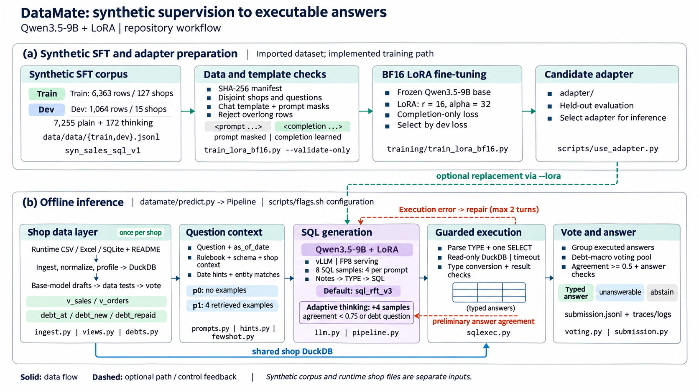

# DataMate · Zalo AI Challenge 2026

**Đội Zaic26-Foxel** · track [DataMate](https://challenge.zalo.ai/portal/datamate) · Qwen3.5-9B + LoRA · DuckDB SQL

Hệ thống trả lời câu hỏi tiếng Việt về dữ liệu bán hàng của từng cửa hàng. Mỗi shop có tệp CSV, Excel hoặc SQLite với cấu trúc riêng.
Với mỗi câu hỏi, mô hình viết nhiều câu SQL DuckDB, chạy chúng trên dữ liệu đã chuẩn hóa rồi bỏ phiếu trên kết quả. Hệ thống chỉ
trả lời khi các mẫu đủ đồng thuận. Đáp án có kiểu (`number`, `percent`, `date`, `string`, `boolean`, `list`, `table`,
`unanswerable`); khi không chắc, hệ thống bỏ trống (`abstain`).

|                   |                                                                                                 |
| ----------------- | ----------------------------------------------------------------------------------------------- |
| Điểm public       | (bản nộp v9). Thang điểm Penalized Accuracy: đúng +1, bỏ trống 0, sai −1               |
| Mô hình           | Qwen3.5-9B (Apache-2.0) + LoRA `sql_rft_v3` (43M), tổng 9,70B tham số (giới hạn 15B)             |
| Chạy private test | Docker offline, 2 × RTX 5090, tối đa 6 giờ kể cả nạp model                                       |

## Mục lục

1. [Workflow](#workflow)
2. [Cài đặt](#cài-đặt)
3. [Inference](#inference)
4. [Docker (bản nộp private)](#docker-bản-nộp-private)
5. [Train LoRA](#train-lora)
6. [Đánh giá và tuân thủ luật thi](#đánh-giá-và-tuân-thủ-luật-thi)
7. [Cấu trúc repo](#cấu-trúc-repo)
8. [License](#license)

## Workflow



Repo có hai luồng với đầu vào tách biệt. Luồng **(a)** train adapter trên bộ SFT tổng hợp. Luồng **(b)** trả lời câu hỏi trên dữ
liệu shop thật. Adapter mặc định là `sql_rft_v3`. Một adapter mới chỉ thay nó (qua `--lora`) khi đạt điểm public cao hơn.

### (a) Chuẩn bị adapter

| Bước          | Code                                         | Nội dung                                                                                                                                     |
| ------------- | -------------------------------------------- | -------------------------------------------------------------------------------------------------------------------------------------------- |
| Bộ SFT        | `data/data/{train,dev}.jsonl`                | `qwen35_sft_clean_v1`, sinh từ `syn_sales_sql_v1`. Train có 6.363 dòng / 127 shop, dev có 1.064 dòng / 15 shop khác; gồm 7.255 dòng thường và 172 dòng thinking |
| Kiểm dữ liệu  | `train_lora_bf16.py --validate-only`         | khớp SHA-256 với `sft_manifest.json`, kiểm train / dev không chung shop hay câu hỏi, áp chat template và mask prompt, loại dòng quá dài       |
| Fine-tune     | `training/train_lora_bf16.py`                | base bf16 đóng băng, LoRA r 16 / alpha 32 trên 248 module, loss chỉ tính trên phần trả lời, chọn checkpoint theo dev loss                     |
| Đổi adapter   | `scripts/use_adapter.py`                     | kiểm tương thích với adapter đang nộp, chép vào `adapters/<tên>/`, cập nhật Dockerfile, manifest và các script chạy                           |

### (b) Inference offline: `datamate/predict.py` → `Pipeline`

| Bước                          | Module                                  | Nội dung                                                                                                                                                                                  |
| ----------------------------- | --------------------------------------- | ----------------------------------------------------------------------------------------------------------------------------------------------------------------------------------------- |
| 1. Lớp dữ liệu (mỗi shop 1 lần) | `ingest.py`, `views.py`, `debts.py`   | Nạp CSV / Excel / SQLite và README vào DuckDB, chuẩn hóa ngày, tiền, tên rồi profile cột. Model gốc (không LoRA) viết 8 bản nháp, các bản nháp được kiểm trên dữ liệu rồi bỏ phiếu để chọn view `v_sales`, `v_orders` và macro công nợ `debt_at`, `debt_new`, `debt_repaid` |
| 2. Ngữ cảnh câu hỏi           | `prompts.py`, `hints.py`, `fewshot.py`  | Prompt gồm câu hỏi, `as_of_date`, rulebook, schema và view, cộng gợi ý khung ngày và giá trị trong dữ liệu khớp câu hỏi. Prompt p0 không có ví dụ; prompt p1 thêm 4 ví dụ train được truy xuất |
| 3. Sinh SQL                   | `llm.py`, `pipeline.py`                 | vLLM chạy FP8 với LoRA, sinh 8 mẫu (4 mẫu mỗi prompt). Mỗi mẫu gồm ghi chú, dòng `TYPE:` và một câu `SELECT`. Câu có độ đồng thuận < 0.75 hoặc là câu công nợ được thêm 4 mẫu thinking |
| 4. Thực thi có kiểm soát      | `sqlexec.py`                            | Tách `TYPE` và đúng một `SELECT`, chạy DuckDB read-only với timeout 20 s, ép kiểu đáp án. Câu chạy lỗi được sửa tối đa 2 lượt                                                              |
| 5. Bỏ phiếu và trả lời        | `voting.py`, `submission.py`            | Gom đáp án theo đúng cách chấm. Với câu công nợ, chỉ các mẫu gọi macro được bỏ phiếu. Hệ thống trả lời khi nhóm thắng đạt ≥ 50% số mẫu; nếu không, hoặc đáp án thắng là 0 / rỗng, thì bỏ trống. `submission.jsonl` được ghi lại sau mỗi shop, kèm trace và log |

Mỗi bước là một method riêng của `Pipeline`. Nhờ vậy `analysis/replay_run.py` dựng lại được prompt và kết quả bỏ phiếu của một
lượt đã lưu mà không cần GPU.

## Cài đặt

| Yêu cầu  | Giá trị                                                                       |
| -------- | ----------------------------------------------------------------------------- |
| GPU      | inference: bf16, từ 24 GB; train BF16: từ 40 GB (T4 / P100 không chạy được)    |
| Phần mềm | CUDA ≥ 12.8, Python ≥ 3.12, `git-lfs`; vLLM 0.32.0, DuckDB 2.0.0               |
| Ổ đĩa    | khoảng 20 GB cho model gốc, khoảng 70 GB nếu build Docker                      |

Phần đọc dữ liệu, chấm điểm, test và các notebook `01_eda`, `03_evaluation` chỉ cần CPU.

```bash
git clone https://github.com/TruongDat05/zaic26-datamate.git && cd zaic26-datamate
git lfs install && git lfs pull                     # adapters/sql_rft_v3
python3 -m venv .venv && .venv/bin/pip install -e ".[llm,dev]"     # chỉ có CPU: dùng .[dev]
.venv/bin/hf download Qwen/Qwen3.5-9B --revision c202236235762e1c871ad0ccb60c8ee5ba337b9a --local-dir models/Qwen3.5-9B
.venv/bin/python -m pytest -q
```

Repo không kèm dữ liệu thi và các file dựng từ dữ liệu đó. Hãy đặt chúng vào đúng chỗ trước khi chạy:

| Đường dẫn                          | Nội dung                                                                                    | Cần cho                                  |
| ---------------------------------- | ------------------------------------------------------------------------------------------- | ---------------------------------------- |
| `data/train/`, `data/public_test/` | dữ liệu của BTC: `questions.jsonl`, `answers.jsonl` (chỉ train), `rulebook.md`, `calendar.csv`, `data/<shop>/` | inference, đánh giá                      |
| `data/data/`                       | bộ SFT tổng hợp `qwen35_sft_clean_v1`: train.jsonl, dev.jsonl, sft_manifest.json             | train LoRA                               |
| `assets/fewshot_bank.jsonl`        | ngân hàng ví dụ từ câu hỏi train; tạo lại bằng `training/build_fewshot_bank.py`              | inference, build Docker                  |
| `configs/public_v9/`               | view và lớp công nợ của lượt nộp v9                                                          | chỉ `run_public.sh` khi không có `FRESH=1` |

## Inference

Mọi lệnh chạy dùng chung bộ flag của bản đã nộp trong `scripts/flags.sh`. Mỗi GPU chạy một tiến trình trên một phần các shop,
và kết quả được gộp vào một `submission.jsonl`.

```bash
bash scripts/run_public.sh runs/public              # dùng lại view và lớp công nợ của lượt 0.683 (configs/public_v9), khoảng 3,5 giờ / GPU 24 GB
FRESH=1 bash scripts/run_public.sh runs/public_new  # soạn lại mọi view và lớp công nợ, giống cách Docker chạy private
bash scripts/run_holdout.sh runs/holdout            # 632 câu holdout của train, chấm điểm vào runs/holdout/score.json
.venv/bin/python -m datamate.submission check runs/public/submission.jsonl --questions data/public_test/questions.jsonl
```

Có thể ghi đè bằng biến môi trường: `NUM_GPUS`, `GPU_MEM` (mặc định `0.92`), `ENGINE` (tham số vLLM dạng JSON),
`MODEL_DIR`, `LORA_DIR`, `PYTHON`. Danh sách flag đầy đủ: `python -m datamate.predict --help`.

> Mỗi lượt chạy sinh mẫu mới, nên cùng một cấu hình có thể lệch khoảng ±1 điểm public. Khi so hai cấu hình, hãy so hai lượt
> chạy đầy đủ.

## Docker (bản nộp private)

Image được build theo hướng dẫn Docker bản cuối của BTC. Base image là `vllm/vllm-openai:v0.32.0`, vì bản 0.10.1.1 BTC gợi ý chưa
chạy được Qwen3.5. Máy build cần có model gốc, LoRA, `assets/fewshot_bank.jsonl`, dữ liệu train, dữ liệu SFT và log train.

```bash
python3 scripts/pack_training_code.py              # build/training_code: code, dữ liệu, log, data_manifest.json (SHA-256)
docker build --platform linux/amd64 -f docker/Dockerfile -t zaic2026_datamate_<team_name>:final .
docker run --rm --gpus '"device=0,1"' --network none --shm-size=16g --entrypoint bash \
    -v /path/to/split:/data:ro -v "$PWD/result:/result" zaic2026_datamate_<team_name>:final /code/predict.sh
```

- `/code/predict.sh` không cần tham số. Script đọc `/data` (chỉ đọc) và ghi `/result/submission.jsonl` sau mỗi shop, nên khi bị
  dừng giữa chừng, các câu đã trả lời vẫn được tính. Log từng câu nằm ở `/result/logs/<id>.json`.
- Container chạy offline và luôn soạn view mới, không dùng `configs/public_v9`. Mỗi tiến trình tự dừng sau 5 giờ 50 phút.
- Mô tả cho BTC nằm ở `docker/README.md` (trong image là `/code/README.md`). Train lại trong image bằng
  `bash /code/training_code/train.sh`.

## Train LoRA

Train SFT LoRA BF16 trên bộ dữ liệu `data/data` bằng một GPU bf16 từ 40 GB (đã cấu hình cho RTX A6000 48 GB):

```bash
python3 -m venv .venv-train
.venv-train/bin/pip install -r training/requirements_bf16.txt
.venv-train/bin/pip install --no-deps fla-core==0.6.0      # kernel Gated DeltaNet
bash training/train_a6000.sh                              # kiểm dữ liệu → kernel fla → preflight bộ nhớ → train; chạy lại thì tiếp tục từ checkpoint
ONLY=data bash training/train_a6000.sh                    # chỉ kiểm dữ liệu (tokenizer, không cần GPU)
```

| Thiết lập | Giá trị                                                                                            |
| --------- | -------------------------------------------------------------------------------------------------- |
| Độ dài    | `--max-len 16384`: mọi dòng dài ≤ 15.942 token (p50 13,1k), giữ toàn bộ dữ liệu                     |
| LoRA      | r 16, alpha 32, dropout 0, 248 module; cùng tên tensor với `sql_rft_v3` nên vLLM nạp được ngay      |
| Tối ưu    | AdamW, lr 1e-4, cosine, warmup 3%, micro-batch 1 × grad-accum 16, 2 epoch (khoảng 796 bước)         |
| Chọn bản  | đánh giá dev loss mỗi 50 bước trên 320 dòng dev cố định; dừng sớm sau 3 lần không giảm              |

Kết quả ghi vào `runs/lora/qwen35_sft_a6000/`: `adapter/` là checkpoint có dev loss thấp nhất, kèm `train_args.json` và
`run_manifest.json`. Các biến môi trường của script được mô tả ở đầu `training/train_a6000.sh`.

Chỉ đổi adapter nộp khi điểm public `FRESH=1` của adapter mới cao hơn bản đang nộp:

```bash
RUN=runs/lora/qwen35_sft_a6000
mkdir -p data/sft_bf16 && cp data/data/{train,dev}.jsonl data/data/sft_manifest.json $RUN/{train_args,run_manifest,trainer_state}.json data/sft_bf16/
python3 scripts/use_adapter.py $RUN/adapter --name qwen35_sft_a6000 --dry-run    # xem trước, không ghi gì
python3 scripts/use_adapter.py $RUN/adapter --name qwen35_sft_a6000
python3 scripts/rule_check.py && python3 scripts/pack_training_code.py
```

Có thêm hai cách khác. Notebook `04_training_data` dựng dữ liệu SFT từ một lượt chạy có nhãn trên train (`training/build_sft.py`,
`add_notes.py`, `split_sft.py`). `training/train_lora.py` (QLoRA 4-bit, Unsloth) là công thức của các adapter đã nộp v1-v3.

### Notebook

| Notebook           | Nội dung                                                                       | Cần              |
| ------------------ | ------------------------------------------------------------------------------ | ---------------- |
| `00_full_pipeline` | gộp 5 notebook bên dưới (`scripts/build_full_notebook.py`)                     | như từng phần    |
| `01_eda`           | shop, tệp, loại đáp án, dạng câu hỏi, một shop sau khi nạp                     | CPU              |
| `02_inference`     | chạy pipeline trên một split, gộp và kiểm tra file nộp                          | GPU bf16 ≥ 24 GB |
| `03_evaluation`    | điểm theo loại / shop / dạng câu, nhóm lỗi, Oracle@K, so hai adapter            | CPU              |
| `04_training_data` | dữ liệu SFT từ lượt chạy có nhãn, chia train / dev theo shop                    | CPU (GPU cho bước ghi chú) |
| `05_train_lora`    | SFT LoRA BF16 trên `data/data`: kiểm dữ liệu, preflight, train, kiểm adapter    | GPU bf16 ≥ 40 GB |

Ô đầu tiên của mỗi notebook tự tìm checkout (máy local, Kaggle, Colab hoặc `DATAMATE_REPO`). Notebook được commit không kèm output,
và `tests/test_notebooks.py` kiểm tra điều này.

## Đánh giá và tuân thủ luật thi

```bash
.venv/bin/python -m datamate.scoring --data data/train --pred RUN/submission.jsonl --output RUN/score.json
.venv/bin/python analysis/err.py RUN [RUN2]          # PA, coverage, Oracle@K, câu bị mất ở bước nào, so cặp hai lượt
.venv/bin/python scripts/rule_check.py               # kiểm tĩnh code và cấu hình theo luật thi; có LỖI thì trả mã thoát 1
```

- Chỉ các công cụ đánh giá đọc đáp án train. Code inference không import `datamate/scoring.py`.
- Các công cụ khác trong `analysis/`: `error_matrix.py` (ma trận lỗi), `gate_cv.py` (chọn ngưỡng bằng leave-one-shop-out),
  `flags.py` và `view_flags.py` (cờ không cần nhãn), `replay_run.py`.
- Holdout (`splits/holdout600.txt`) chỉ dùng để kiểm tra nhanh, vì LoRA v3 đã học một phần câu của các shop này
  (xem [docs/leaderboard.md](docs/leaderboard.md)).
- Luật thi: inference offline, không có người can thiệp, một model ≤ 15B tham số. Code không hard-code theo id câu hỏi hay id shop,
  không train trên tập test, và chạy xong toàn bộ private test trong 6 giờ. Log từng câu được giữ để BTC chạy lại (Rule 8).

## Cấu trúc repo

```
datamate/          package inference: predict (CLI), pipeline, llm (vLLM), ingest, views, debts, hints, prompts,
                   fewshot, sqlexec, voting, submission, scoring (chỉ dùng khi đánh giá)
training/          train LoRA: train_lora_bf16.py, train_a6000.sh, build_sft / add_notes / split_sft, check_fla, merge_lora,
                   train_lora.py (QLoRA v1-v3)
scripts/           flags.sh, run_public.sh, run_holdout.sh, use_adapter.py, pack_training_code.py, rule_check.py
docker/            Dockerfile, predict.sh, train.sh, README cho BTC, model_manifest.json
adapters/          sql_rft_v3 (LoRA đang nộp, Git LFS)
analysis/          công cụ đánh giá offline
notebooks/         00_full_pipeline, 01_eda → 05_train_lora
splits/, tests/, docs/, figures/
```

Không có trong repo: `data/`, `assets/fewshot_bank.jsonl`, `configs/public_v9/` (xem [Cài đặt](#cài-đặt)), `models/` (trọng số gốc)
và `runs/` (kết quả chạy, log, checkpoint).

## License

Code, LoRA adapter và ngân hàng ví dụ theo [MIT License](LICENSE). Model Qwen3.5-9B tải riêng và theo license Apache-2.0 của Qwen.
Dữ liệu của BTC không thuộc license này. Code dựng trên baseline AIO
([hugebenevolence/zalo-ai-challenge-datamate-26](https://github.com/hugebenevolence/zalo-ai-challenge-datamate-26), MIT), có bổ sung
`scripts/rule_check.py` và hỗ trợ đọc `.xls`, `.xlsm`.

Tài liệu thêm: [Đề bài](docs/challenge.md) · [Ghi chú dữ liệu](docs/data-notes.md) · [Lịch sử điểm](docs/leaderboard.md)
