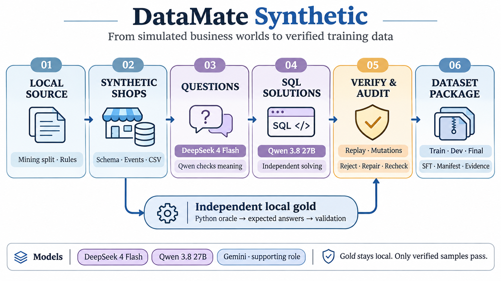

# DataMate Synthetic

Pipeline sinh dữ liệu tổng hợp cho bài toán trả lời câu hỏi tiếng Việt trên sổ bán hàng. Mỗi mẫu kết hợp dữ liệu shop, câu hỏi, đáp án chuẩn và lời giải SQL đã kiểm chứng.



## Quy trình

| Bước | Xử lý |
| --- | --- |
| **1. Chuẩn bị nguồn** | Trích schema, kỹ năng, quy ước và phân bố từ phần mining của train; tách dữ liệu đánh giá. |
| **2. Mô phỏng shop** | Sinh danh mục, giao dịch, thanh toán, công nợ và tình huống biên; xuất bảng rồi nạp lại bằng runtime. |
| **3. Sinh câu hỏi** | Viết câu hỏi từ đặc tả; model độc lập đọc ngược để kiểm số đo, đối tượng và kỳ thời gian. |
| **4. Sinh lời giải SQL** | Giải từ câu hỏi và ngữ cảnh shop, không cung cấp đáp án chuẩn cho model. |
| **5. Kiểm chứng và audit** | Kiểm tĩnh, thực thi lặp, so gold, thử trên dữ liệu đột biến và audit mẫu phân tầng; loại hoặc sửa mẫu lỗi rồi kiểm lại. |
| **6. Đóng gói dữ liệu** | Chọn theo phân bố mục tiêu, tách train/dev/final; xuất gói nguồn và chuyển qua exporter SFT với manifest, bằng chứng truy vết. |

**Gold được tính độc lập bằng oracle Python trên máy**, kể cả khi dữ liệu bị đột biến. Final được giữ riêng làm benchmark, không dùng để chọn mẫu train.

## Model

| Model | Vai trò |
| --- | --- |
| **DeepSeek 4 Flash** | Sinh câu hỏi từ đặc tả và bổ sung lời giải. |
| **Qwen 3.8 27B** | Kiểm nghĩa câu hỏi bằng đọc ngược và sinh SQL. |
| **Gemini** | Hỗ trợ diễn đạt, sinh thêm câu hỏi và audit độc lập. |

## Cài đặt

Cần Python 3.12, `uv` và runtime SQL tương thích có `datamate/`, `harness_control/`, `training/`.

```bash
export DATAMATE_CONTROLLER=/absolute/path/to/datamate_foxel
export DATAMATE_UPSTREAM="$DATAMATE_CONTROLLER"

uv venv --python 3.12 .venv
uv pip install --python .venv/bin/python -r requirements.txt

uv venv --python 3.12 .venv-sql
uv pip install --python .venv-sql/bin/python \
  -r requirements.txt -e "${DATAMATE_CONTROLLER}[dev]"

export SYNTH_PY="$PWD/.venv/bin/python"
export SQL_PY="$PWD/.venv-sql/bin/python"
cp .env.example .env
```

Điền các biến API trong [`.env.example`](.env.example): `API_*` cho DeepSeek 4 Flash, `MK_*` cho Qwen 3.8 27B và `GEMINI_*` cho Gemini. `DATAMATE_CONTROLLER` chứa công cụ và `build/`; `DATAMATE_UPSTREAM` chọn runtime hoặc snapshot dùng để kiểm chứng. Giữ cùng revision runtime trong một lượt sinh và export.

Đặt dữ liệu nguồn trong `data/train/`, gồm `data/<business_id>/`, `questions.jsonl`, `answers.jsonl`, `calendar.csv` và `rulebook.md`. Bước dựng nguồn giữ `pandas==2.2.3` theo `requirements.txt`.

## Generate dữ liệu

Ví dụ một lượt sinh trên nhóm shop train thuộc các ngành lõi:

```bash
# Dựng nguồn và mô phỏng shop
"$SYNTH_PY" eval/build_synth_source.py
"$SYNTH_PY" eval/build_data_spec.py
"$SQL_PY" eval/sqlv1/shops.py build --procs 4

# Sinh câu hỏi và kiểm nghĩa độc lập
mkdir -p outputs/synth_sql_v1/questions
"$SQL_PY" eval/sqlv1/questions.py gen \
  --shops core_train --n-per-shop 24 --seed initial \
  --teacher deepseek --verifier qwen --workers 4 --out gen_train
"$SQL_PY" eval/sqlv1/pool.py

# Sinh SQL và kiểm chứng
"$SQL_PY" eval/sqlv1/solve.py run \
  --pool outputs/synth_sql_v1/questions/pool_train.jsonl \
  --provider qwen --procs 4
```

Xem [hướng dẫn đầy đủ](eval/README.md) để sinh đủ train/dev/final, bổ sung lời giải, audit và xuất SFT. Số mẫu được giữ phụ thuộc kết quả kiểm chứng; gói nguồn cần qua exporter trước khi sử dụng để huấn luyện.

## Cấu trúc

```text
datamate/           Loader, tính toán và sandbox phục vụ dựng nguồn
eval/sqlv1/         Pipeline SQL: mô phỏng, câu hỏi, oracle, solver, kiểm và đóng gói
eval/synth_*.py     Mô phỏng và công cụ corpus dùng chung
eval/synth_prompts/ Prompt sinh dữ liệu
tests/              Kiểm contract và regression
docs/assets/        Ảnh workflow
```

Dữ liệu và artifact chạy nằm trong `data/`, `outputs/` và thư mục `build/` của controller. `.gitignore` loại dữ liệu, output, cache, log, database, môi trường ảo, khóa API và model weights khỏi các commit mới.
